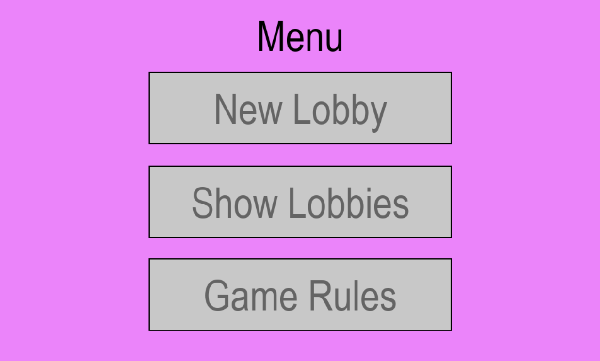
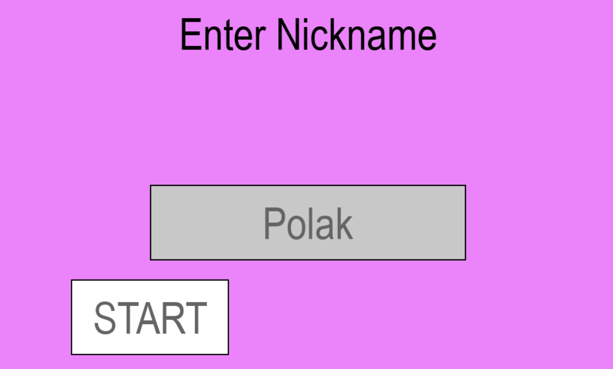
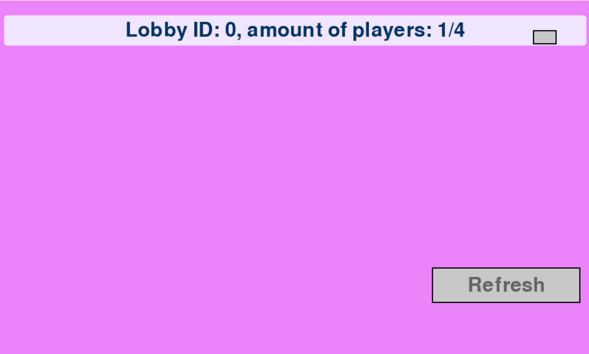
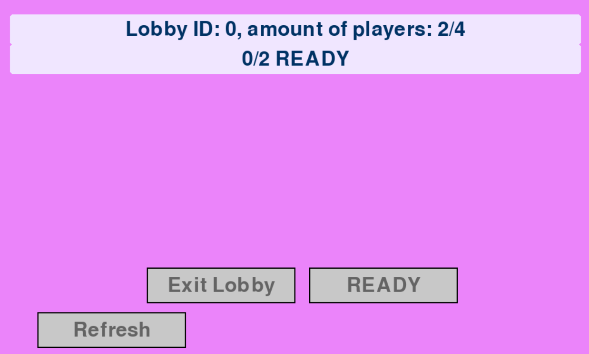
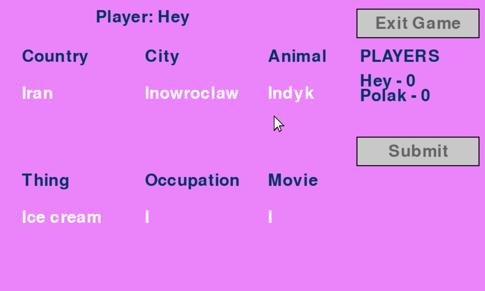
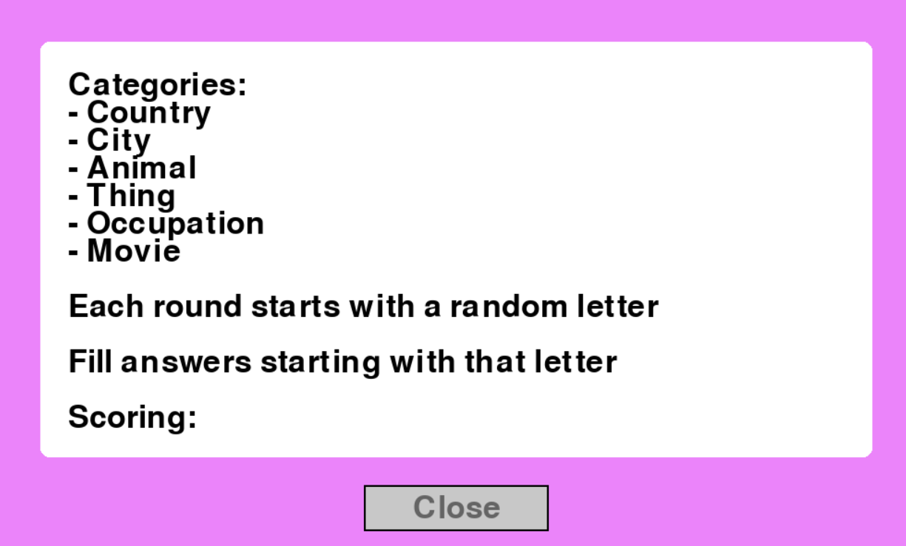

# Stop the Bus (Państwa-Miasta) - Multiplayer Game

## Overview

**Stop the Bus** (known as **"Państwa-Miasta"** in Polish) is a classic word game where players compete to come up with unique answers for various categories starting with a given letter. This project implements a **multiplayer version** of the game using a **client-server architecture**, featuring **lobbies**, **real-time gameplay**, and **scoring**.

The game supports up to 4 players per lobby, with 3 rounds per game. Players submit answers for categories like
Country, City, Animal, Thing, Occupation and Movie, validated against predefined
dictionaries. Points are awarded based on answer excistence and uniqueness,
and a final leaderboard is displayed after the game ends.

---

## Features

### Game Features

- **Menu System**: Create or join game lobbies  
- **Lobby Management**:  
  - Create new lobbies (up to 4 players)  
  - Join existing lobbies  
  - Ready/Unready system  
  - Lobby refresh  
- **Gameplay**:  
  - Real-time answer submission  
  - Countdown timer  
  - Category validation  
  - Dynamic scoring  
- **Results Display**:  
  - Round-by-round results  
  - Final leaderboard  
- **User Interface**:  
  - Pygame-based graphical interface  
  - Interactive buttons  
  - Visual feedback  

### Server Features

- **Lobby Server**:  
  - Manages game lobbies - creation, joining and leaving
  - Handles player connections ensuring nicknames uniqueness
  - Tracks ready status and starts the game when everyone is ready
  - Sends real-time updates to clients about lobby status
- **Game Server**:  
  - Validates answers against category dictionaries  
  - Calculates scores based on excistence and their uniqueness:
    - 15 points: Only valid answer in category
    - 10 points: Valid answer
    - 5 points: Duplicate valid answer
    - 0 points: No answer at all
  - Manages 3 rounds per game, tracking rounds and player score  
  - Enforces game rules
---

## Installation

### Prerequisites

- **Python 3.x**  
- **pygame** library  
- **pandas** library  
- **Dictonary files** - text files in the dictonaries/ folder for answer validation
- **Image assets** - cursor image (images/cursor.png) for the GUI

### Setup

1. Clone the repository
2. Install dependencies:  
pip install pygame pandas

3. Run the servers (in separate terminals):  
python server_lobby.py  
python server_game.py

4. Run the client:  
python client.py

---

## How to Play

### Main Menu

- Choose an option:
  - **New Lobby:** Create a new lobby with a unique ID
  - **Show Lobbies:** View a list of available lobbies to join
  - **Games Rules:** Read the rules of the game
- Enter your nickname to proceed  

### Lobby

- **Create Lobby** - starts a new lobby where you wait for the game start
- **Join Lobby** - select an existing lobby from the list (up to 4 players)
- **Ready/Unread** - click the "Ready" button to signal readiness, click "Unready" to toggle off. 
- **Refresh** - Updates the lobby list or how many players there are in the lobby
- **Exit** - Leave the lobby and return to the main menu
- The game automatically runs when all the players are ready

### Gameplay

- **Round start** - the server assigns a random letter
- **Enter answers** - Type answers for each of the category
- **Submit answers** - Click "Submit" to send answers to the server
- **Countdown** - After the first player submits, a 10 second countdown begins for all the players
- **Results** - After each round, view all players' answers and their scores

### Results

- **Round result** - View round results after each submission  
- **Final leaderboard** - See final leaderboard after 3 rounds  

---

## Game Rules

- **Categories**: Country, City, Animal, Thing, Occupation, Movie  
- **Rounds**: 3 per game  
- **Scoring**:  
- **15 points**: Only correct answer in category  
- **10 points**: Correct and unique answer (but others answered too)  
- **5 points**: Duplicate correct answer  
- **0 points**: Incorrect or empty answer  
- **Time limit**: 10 seconds after the first player submits  

---

## Project Structure
- **game.py** -  Main game client with UI  
- **server_lobby.py** -  Lobby management server  
- **server_game.py** -  Game logic server  
- **network_utils.py** - utility functions for TCP socket communication and client handling
- **dictionaries/** -  Category validation files  
- **images/** -  Game assets  

---

## Technical Details

- **Networking**: 
  - TCP socket communication on ports 61111 (lobby server) and 61112 (game server)
  - Messages are newline-terminated strings(e.g JOIN <lobby_id> <nickname>)
  - Client-server communication handled by network_utils.py
- **Threading**: Multi-threaded servers handle multiple clients
  - Multithreading servers use threading.Thread for concurrent client handling
  - Thread-safe operations with threading.lock for shared data (e.g lobbies, lobbies_ready)
- **Data Validation**: Answers checked against category-specific dictionaries
  - Answers validated against category-specific text files in dictionaries/
- **State Management**: Thread-safe operations with locking 
  - Lobby Server tracks lobbies, lobbies_ready, and nicknames
  - Game server manages lobbies, answers_for_lobby, letter_for_body, and rounds_per_lobby
- **GUI**
  - Pygame renders 1000x600 window with interactive buttons and text fields
  - Custom Button class handles click detection and hover effects
  - Data managed using a pandas DataFrame for categories and answers

---

## Contributions

### Mikołaj Woźniak

### Szymon Róźycki
- created idea of the game
- designed UI
- designed logic behind storing answers
- designed cursor movement
- developed dictionaries and images
- managed error handling
- developed functionality of showing round results
- developed functionality of showing leaderboard results
- tested game bugs and fixed inconsistencies
- developed README file

### Michal Sondej
- improved the visual presentation of the game
- added rules screen
- added exit game functionality
- added leave lobby functionality
- developed README file

---

## Screenshots of the game

### Starting menu

### Lobby creation

### List of lobbies

### Inside the lobby

### Game round

### Game rules

---

## Credits

Developed as a **Python networking project**.  
Inspired by the classic game **"Państwa-Miasta"**.

